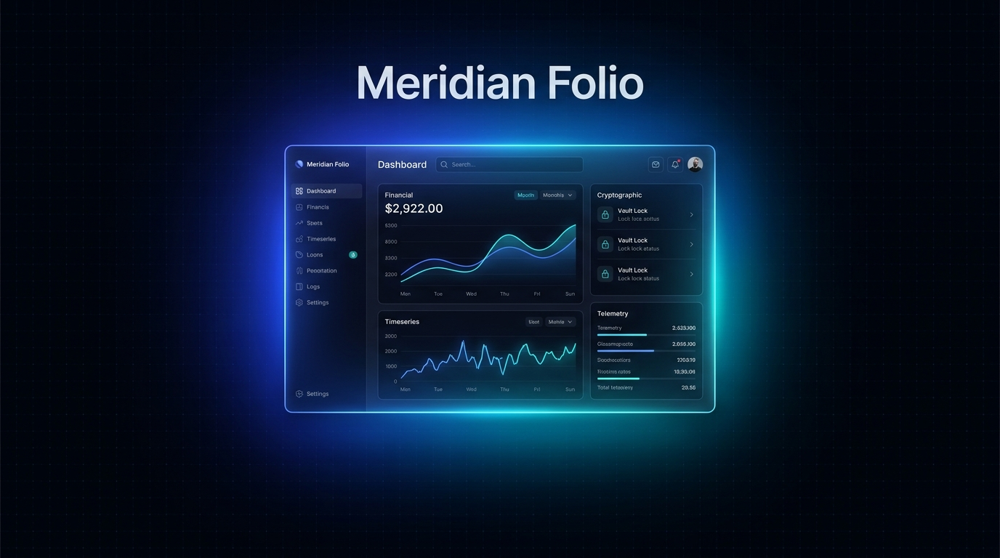
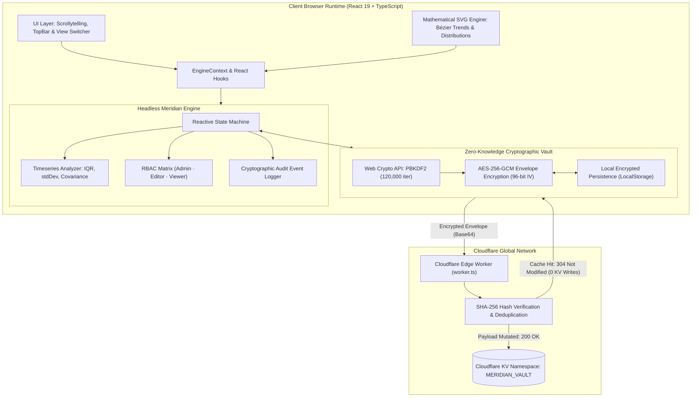
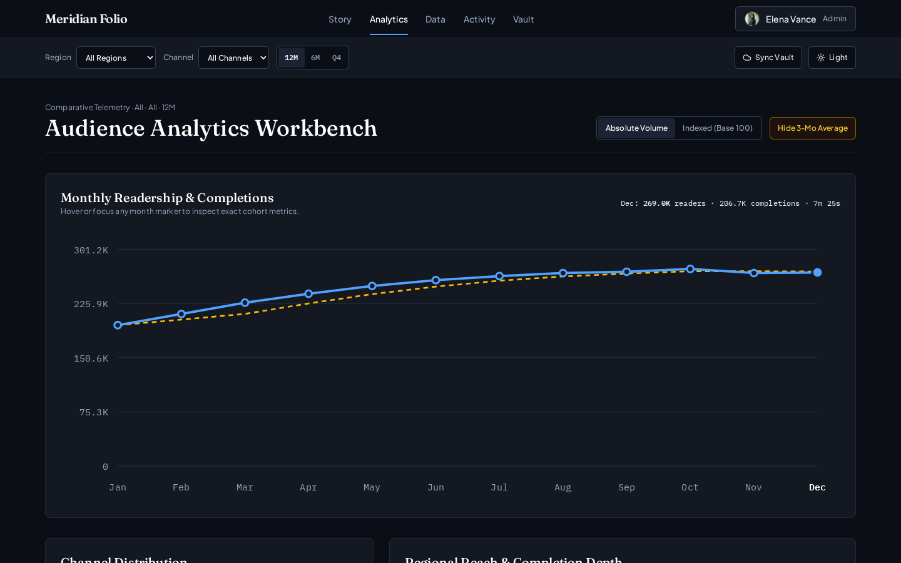
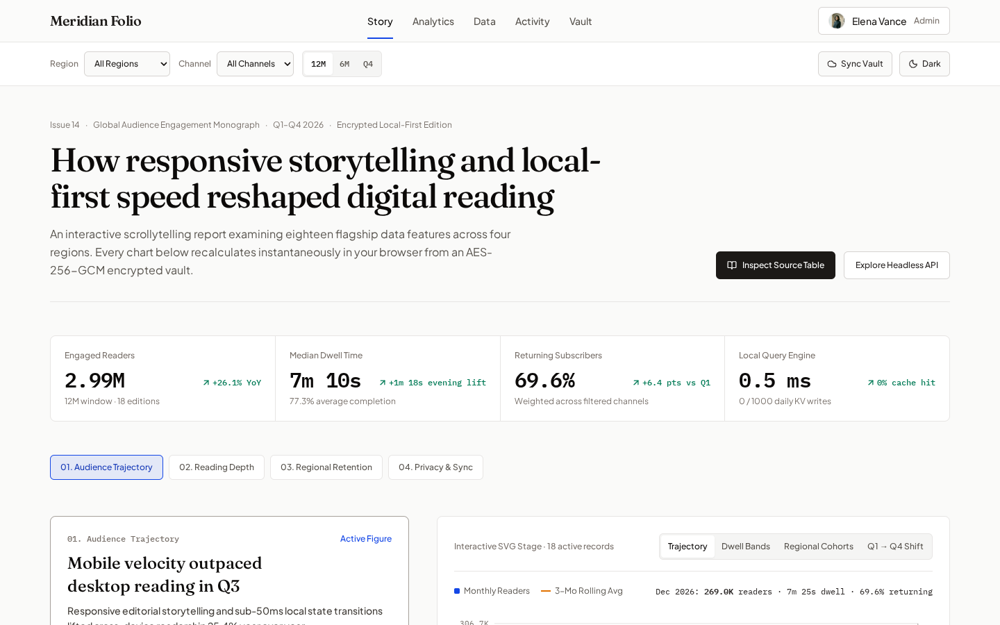
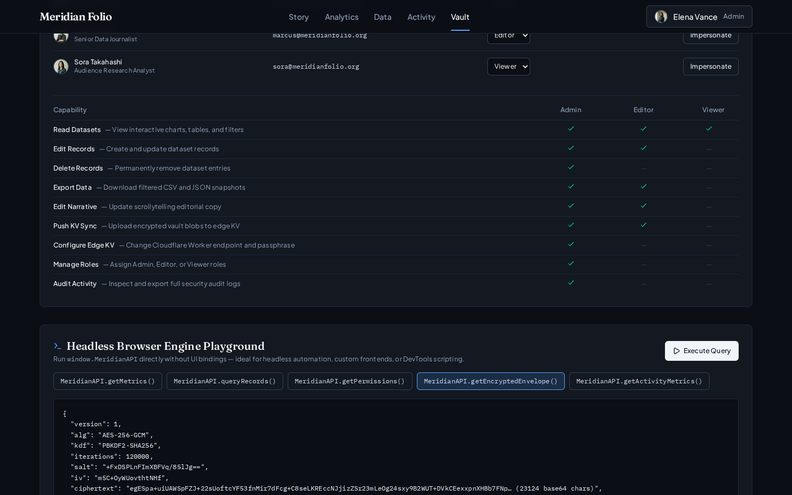
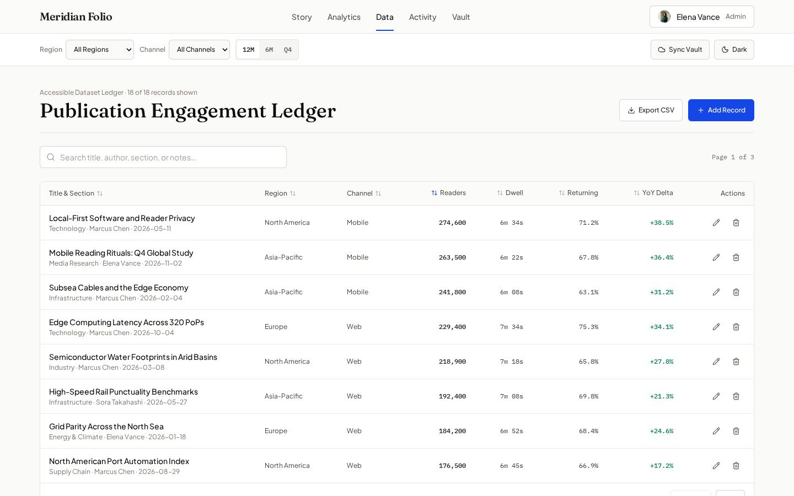

<div align="center">



<br />
<br />

# Meridian Folio

**Interactive Editorial Data Visualization & Encrypted Local-First Dashboard**

[](https://react.dev/)
[](https://www.typescriptlang.org/)
[](https://tailwindcss.com/)
[](https://developer.mozilla.org/en-US/docs/Web/API/Web_Crypto_API)
[](https://workers.cloudflare.com/)

<br />

[Architecture](#-system-architecture) •
[Interface Gallery](#-interface-gallery) •
[Core Features](#-core-features) •
[Security & Encryption](#-security--encryption) •
[Cloudflare Edge Sync](#-cloudflare-edge-sync) •
[Quickstart](#-quickstart) •
[Repository Structure](#-repository-structure)

</div>

---

## Overview

**Meridian Folio** is an offline-capable, editorial data visualization platform and local-first dashboard. It combines reactive mathematical vector charts, narrative scrollytelling interfaces, client-side cryptographic vaults (AES-256-GCM), and edge synchronization with Cloudflare Workers KV.

---

## ✦ System Architecture



---

## ✦ Interface Gallery

<div align="center">
  <table>
    <tr>
      <td width="50%">
        
        <p align="center"><em>Dark Mode — Analytics Stage & Real-time Metrics</em></p>
      </td>
      <td width="50%">
        
        <p align="center"><em>Light Mode — Editorial Scrollytelling & Narrative Focus</em></p>
      </td>
    </tr>
    <tr>
      <td width="50%">
        
        <p align="center"><em>Cryptographic Vault & Cloudflare Edge Sync Inspector</em></p>
      </td>
      <td width="50%">
        
        <p align="center"><em>High-Density Data Grid with Multidimensional Sorting</em></p>
      </td>
    </tr>
  </table>
</div>

---

## ✦ Core Features

- **Mathematical SVG Engine:** Custom cubic-Bézier area curves, dwell-time histograms, regional scatter matrices, and channel slope graphs built directly with SVG primitives—zero external charting bloat.
- **Scrollytelling Interface:** Synchronized narrative progression driving dynamic facet filtering and highlighted data regions.
- **Role-Based Access Control (RBAC):** Three operational tiers (Admin, Editor, Viewer) managing nine granular permissions from dataset ingestion to cryptographic audit export.
- **Real-Time Audit Trail:** Continuous event tracking capturing state mutations, authentication events, and cryptographic operations.

---

## ✦ Security & Encryption

Meridian Folio implements client-side encryption via the W3C Web Crypto API (`window.crypto.subtle`):

- **Key Derivation:** Master passphrases derived with PBKDF2 using 120,000 rounds of SHA-256 and unique 16-byte random salts.
- **Cipher:** AES-256-GCM authenticated encryption utilizing unique 96-bit initialization vectors (IVs) generated per envelope.
- **Zero Plaintext Transmission:** The backend relay and edge storage only receive ciphertext envelopes; plaintext data is strictly confined to the authenticated client runtime.

---

## ✦ Cloudflare Edge Sync

The edge sync worker (`cloudflare/worker.ts`) provides high-efficiency KV synchronization:

- **ETag Deduplication:** Computes the SHA-256 hash of inbound envelopes. Payloads identical to the active version bypass KV write calls, conserving free-tier quotas.
- **Cache Optimization:** Supports `If-None-Match` HTTP headers, returning `304 Not Modified` when local and remote digests match.

```bash
# Cloudflare Worker deployment
wrangler kv namespace create MERIDIAN_VAULT
wrangler secret put SYNC_TOKEN
wrangler deploy
```

---

## ✦ Quickstart

```bash
# Clone repository
git clone https://github.com/ommd3076/interactive-pdf.git
cd interactive-pdf

# Install dependencies
npm install

# Setup local environment
cp .env.example .env

# Run fullstack development server
npm run dev
```

Application will run locally on `http://localhost:3000`.

---

## ✦ Repository Structure

```
interactive-pdf/
├── .github/
│   └── assets/                     # Visual assets, diagrams, and hero banner
├── cloudflare/
│   ├── worker.ts                   # Cloudflare Worker with ETag deduplication
│   └── wrangler.toml               # Wrangler configuration & KV bindings
├── src/
│   ├── assets/images/              # Avatars and UI images
│   ├── components/                 # React UI components
│   │   ├── charts/                 # Native mathematical SVG charting
│   │   ├── ActivityView.tsx        # Security & audit logging
│   │   ├── AnalyticsView.tsx       # Metric dashboards & timeseries
│   │   ├── AuthModal.tsx           # Session & passphrase unlock
│   │   ├── DataTableView.tsx       # Dense tabular data interface
│   │   ├── FilterToolbar.tsx       # Facet filters (timeframe, channel, region)
│   │   ├── StoryView.tsx           # Scrollytelling narrative interface
│   │   ├── TopBar.tsx              # System navigation & theme toggle
│   │   └── VaultView.tsx           # Cryptographic vault inspector
│   ├── context/
│   │   └── EngineContext.tsx       # Engine context provider & hooks
│   ├── engine/                     # Headless data & state engine
│   │   ├── analytics.ts            # Quartiles, deviations, mathematical formulas
│   │   ├── crypto.ts               # Web Crypto API AES-256-GCM utilities
│   │   ├── engine.test.ts          # State engine unit tests
│   │   ├── kvSync.ts               # Remote edge sync client
│   │   ├── MeridianEngine.ts       # Reactive state machine
│   │   ├── rbac.ts                 # Access control definitions
│   │   ├── seedData.ts             # Default data sets & stories
│   │   └── types.ts                # TypeScript types & interfaces
│   ├── App.tsx                     # Main layout shell
│   ├── index.css                   # Typography & styling
│   └── main.tsx                    # Client entrypoint
├── index.html                      # HTML shell
├── package.json                    # Dependencies & scripts
├── server.ts                       # Express dev proxy server
├── tsconfig.json                   # TypeScript config
└── vite.config.ts                  # Vite build config
```
